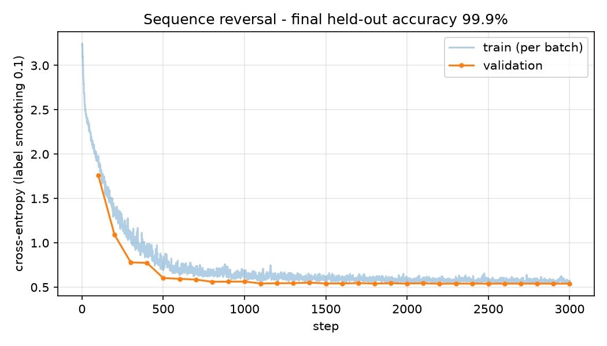
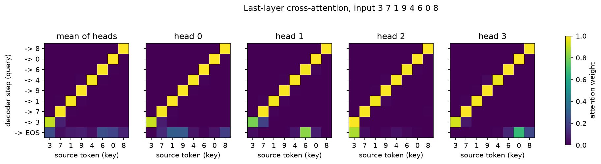
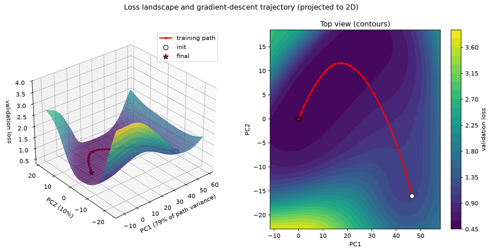

# Transformer from scratch: digit-sequence reversal

A small encoder–decoder Transformer (post-LN, as in *Attention Is All You Need*, arXiv 1706.03762)
written in plain PyTorch and trained on a toy task: reverse a sequence of 3–10 digits.

```
input : 3 7 1 9 4 6 0 8
output: 8 0 6 4 9 1 7 3
```

## Results

| Setting | Value |
|---|---|
| Model | 2 encoder + 2 decoder layers, d_model 64, 4 heads, d_ff 128 (~0.17M params) |
| Training | 3000 steps, batch 64, Adam + warmup schedule from the paper, label smoothing 0.1 |
| Held-out exact-sequence accuracy | 99.9 % (1000 random sequences, greedy decoding) |

Validation loss settles around 0.54 rather than 0 because label smoothing gives the loss a non-zero floor.



The last decoder layer's cross-attention forms a clean anti-diagonal: to emit the *i*-th output digit,
every head attends to source position *n − 1 − i*.



### Loss landscape and training trajectory

Weights are saved every 100 steps. PCA on the trajectory gives the two directions in which the
weights moved most (here 79 % + 10 % of the path variance). The surface is the validation loss on
the plane spanned by those directions around the final weights; the red line is the training path
projected onto that plane (method: Li et al. 2018, *Visualizing the Loss Landscape of Neural Nets*).



This is a 2D slice of a ~0.17M-dimensional space: losses on the plane are not the true losses
along the trajectory (e.g. the projected start sits near 1.3, while the real initial loss is about 3.2).

## Run

```bash
pip install torch matplotlib
python transformer.py      # smoke test of the model (shapes, gradients, causal mask)
python train_reverse.py    # trains (~1 min on a laptop GPU) and writes outputs/*.png
```

## Files

- `reverse_transformer.ipynb` — step-by-step notebook (Chinese notes) covering the model, training and all plots; self-contained.
- `transformer.py` — multi-head attention, encoder/decoder layers, sinusoidal positions, tied embeddings, LR schedule.
- `train_reverse.py` — data generation, training loop, greedy decoding, loss/attention/landscape plots.

## Limitations

Toy task only; this is not a trained translator and does not reproduce the paper's BLEU scores.
No KV cache, so greedy decoding re-runs the full decoder each step.
